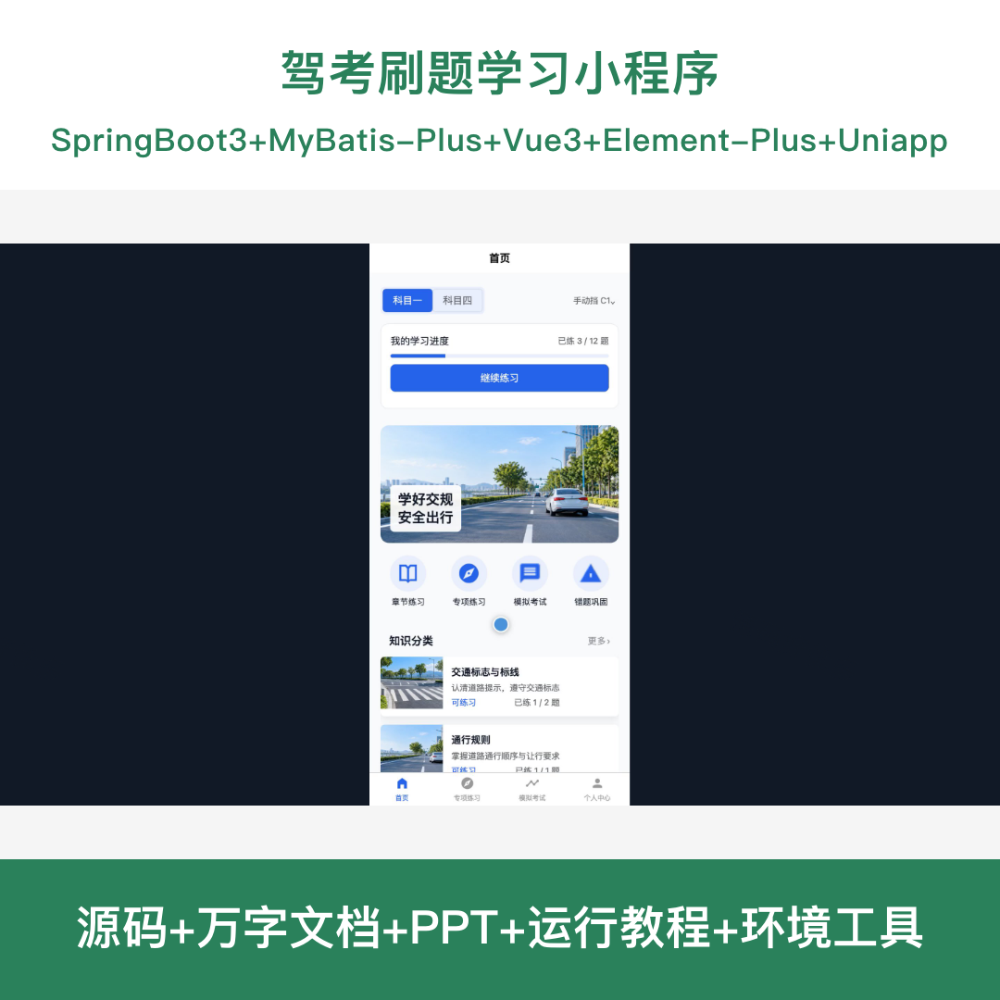
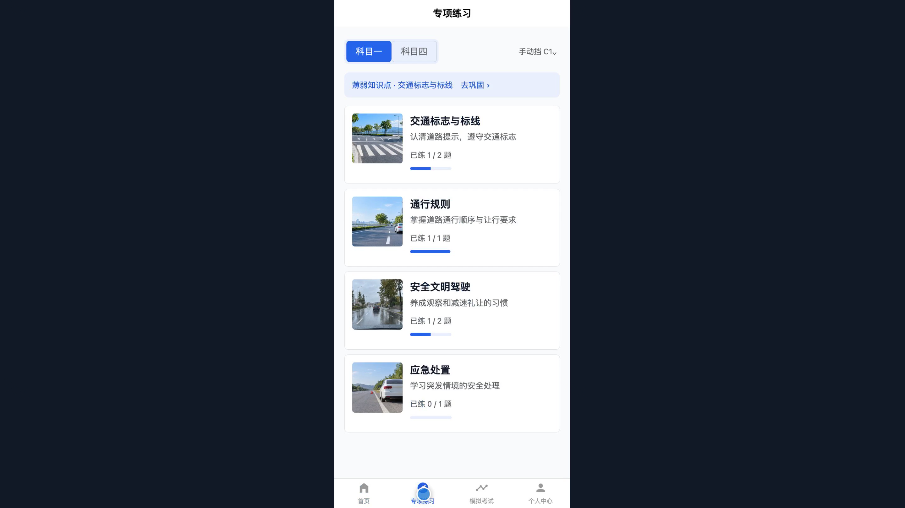
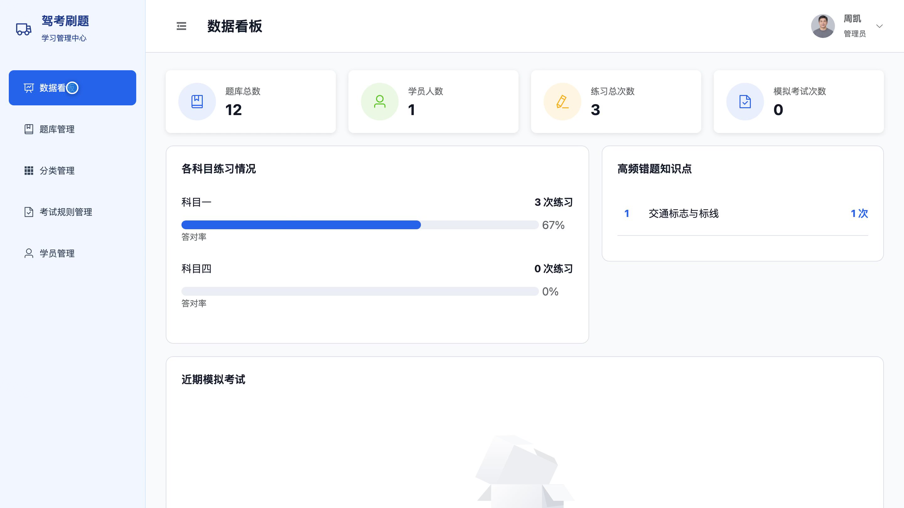
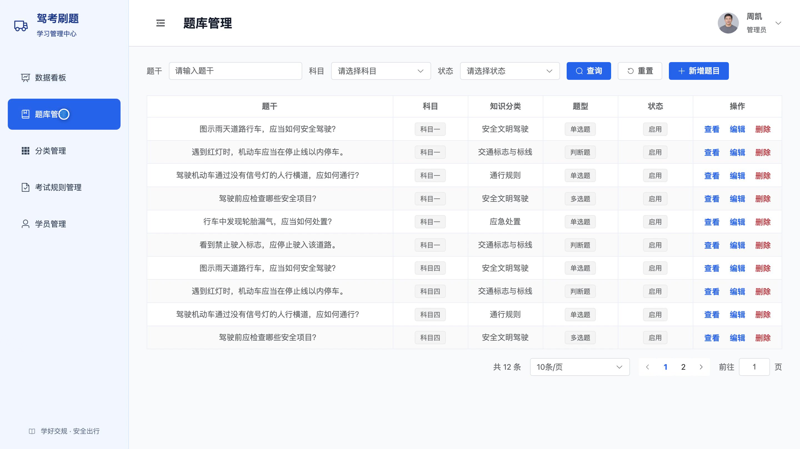
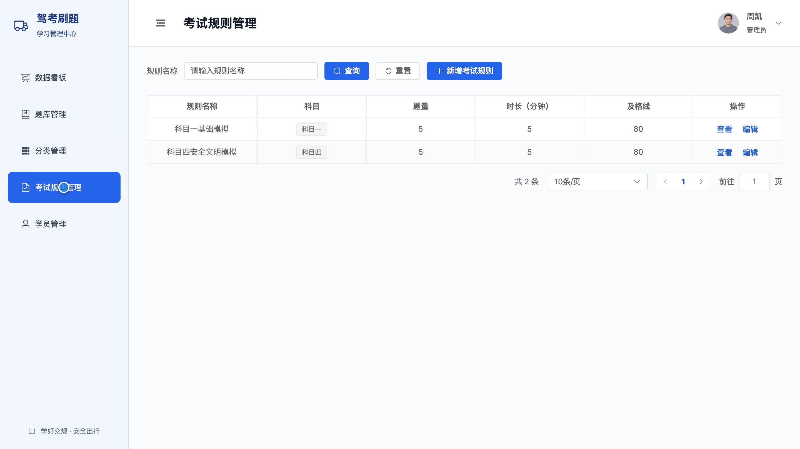

# bs142B
bs142B驾考刷题学习小程序源码 Java SpringBoot3 Vue3 前后分离
## 源码问题查看主页咨询

### 一、关键词
驾考刷题、科目一练习、科目四题库、驾驶理论考试、模拟考试

### 二、作品包含
源码+数据库+万字设计文档+PPT+全套环境和工具资源+本地部署教程

### 三、项目技术
前端技术： Html、Css、Js、Vue3.4、Element-Plus、uniapp
后端技术：Java、SpringBoot3.2.0、MyBatis-Plus

### 四、运行环境要求
开发工具：IDEA/eclipse + VSCODE + HBuilder X + 微信开发者工具

数据库：MySQL5.7+（共9张表）

数据库管理工具：Navicat10以上版本

环境配置软件： JDK17 + Maven3.6

前端Nodejs：16+

浏览器：谷歌浏览器

### 五、项目介绍
项目编号：bs142B

驾考刷题学习小程序面向学员和管理员，提供科目一与科目四题库、章节及专项练习、模拟考试、错题巩固和学习记录；管理员可维护题库、知识分类、考试规则与学员账号，并查看学习数据。

角色：用户、管理员

用户功能：注册登录、按车型和科目练习题目、章节与专项练习、模拟考试与成绩查看、错题重练、题目收藏、学习记录查看、个人资料与密码维护。

管理员功能：后台登录、题库管理、知识分类管理、考试规则管理、学员账号与学习记录管理、学习数据统计。

### 六、运行截图

